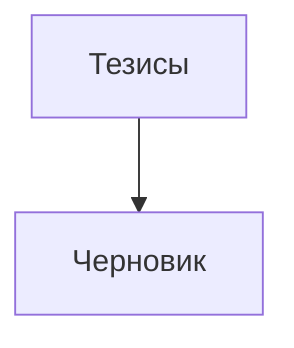
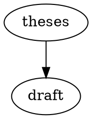

# Markdown для pandocster

Пиши обычный Markdown. Сборка сама сдвигает заголовки, ставит якоря, собирает
ссылки, копирует картинки и раскрывает переменные с нумераторами. Исходники
при этом не меняются.

Не пиши вручную `<!-- @header-offset: N -->`, `<!-- @anchor="..." -->` и файл
`999-reflinks.md`.

## Дерево

Текст лежит в `.md` под `src/`. Картинки — рядом с файлом или в `src/assets/`.
`src/templates/` сборка не читает.

Корень структуры — каталог сборки, если `.md` лежит прямо в нём. Иначе это
родитель первого каталога с `.md`. В каркасе `pandocster init` корень —
`src/md`, если файлы лежат в `src/md/<раздел>/`.

```text
src/md/01-intro/_index.md
src/md/01-intro/01-terms.md
src/md/02-method/_index.md
src/assets/scheme.png
```

В каталоге сначала обрабатывается `_index.md`, затем остальные `.md` по имени.
Вложенный каталог встаёт на своё место по имени, и его `_index.md` тоже раньше
соседних файлов. Порядок задавай префиксами `01-`, `02-`.

Верхний заголовок каждого файла — `#`. Сдвиг считает сборка, глубину в решётках
не кодируй. Следующие заголовки того же файла пиши как `##` и `###`.

| Файл | Что видит читатель |
| --- | --- |
| `#` в корневом `_index.md` | H1 |
| `#` в `_index.md` на один каталог глубже | H2 |
| `#` в файле рядом с этим `_index.md` | H3 |
| `##` в том же соседнем файле | H4 |

В `_index.md` обычно только заголовок раздела. Текст туда класть можно, но `#`
этого файла на уровень выше, чем `#` файлов рядом.

## Перекрёстные ссылки

Определение занимает всю строку. Цель — относительный путь к `.md` внутри корня
структуры. В тексте остаётся ссылка по метке.

```markdown
Подробности в [терминах][terms].

[terms]: ./01-terms.md
```

Сборка вырезает такие строки и собирает их в служебный `999-reflinks.md` как
`[terms]: #01-intro_01-terms.md`. Якорь — путь от корня структуры, части
склеены `_`, имя файла остаётся.

Метка уникальна на весь документ. Одна и та же метка на разные файлы даёт
предупреждение, а не ошибку.

Не превращаются в якорь:

- обычная ссылка `[текст](01-terms.md)`;
- `http://`, `https://`, `mailto:`, ссылка на `#якорь`;
- цель не на `.md` или файл вне корня структуры.

## Картинки

Пиши inline-картинку. Путь считается от файла, в котором она стоит.

```markdown

```

Локальный файл копируется в `build/resources/`, путь в копии переписывается.
Адреса `http://`, `https://`, `ftp://`, `mailto:`, `data:` и `#` не
копируются. Если файла нет или он лежит вне дерева сборки, ссылка остаётся как
есть и печатается предупреждение.

## Переменные

Имена объявляются в `pandocster.yaml`. Перед новым именем прочитай файл. Нет
ключа — добавь его только в `pandocster.variables` или `pandocster.numerators`.

```yaml
pandocster:
  variables:
    product: Pandocster
    year: 2026
    draft: true
    authors:
      - Анна
      - Борис
```

```markdown
# {{ product }}

Год {{year}}, черновик {{draft}}.

{{ authors }}
```

`{{ product }}` и `{{product}}` — одно имя. Имя состоит из букв, цифр и `_`.
Строка и число попадают в текст как есть. Логическое значение становится
`true` или `false`, пустое — пустой строкой. Список и словарь вставляются
фрагментом YAML и второй раз не разбираются: `{{другое_имя}}` внутри значения
останется текстом.

`\{{product}}` остаётся буквально `\{{product}}`. В инлайн-коде и в
fenced-блоке, включая mermaid и graphviz, замены нет. Неизвестное имя
останавливает сборку: в сообщении будут имя, файл и номер строки.

Узла `variables` может не быть. Пустой словарь тоже значит, что замены нет.

## Нумераторы

Маркер всегда начинается с решётки. `{{имя}}` без неё — переменная, даже если
имя совпадает с нумератором. Знак `=` сразу после решёток отличает ссылку от
генератора.

```markdown
{{#:para}} Первый абзац
{{#:para}} Второй абзац
{{#}} Абзац другого нумератора
{{#:para}} Третий абзац
{{#}} Ещё один абзац другого нумератора
```

После сборки:

```markdown
1. Первый абзац
2. Второй абзац
1. Абзац другого нумератора
3. Третий абзац
2. Ещё один абзац другого нумератора
```

Полная форма генератора — `{{#:имя:значение}}`.

- Одна решётка — плоский номер, две — иерархический.
- `{{#}}` и `{{#::значение}}` относятся к нумератору `default`.
- `{{#:para}}` и `{{#:para:}}` каждый раз получают новый номер. Сослаться на
  него нельзя: у него нет имени значения.
- `{{ #: para : item }}` и `{{#:para:item}}` — один и тот же маркер.
- Имя нумератора и имя значения — буквы, цифры и `_`. Дефис не принимается:
  `{{#:para:foo-bar}}` останется текстом.
- Незакрытый `{{#` тоже остаётся текстом. Сборка из-за него не останавливается.
- `\{{#:para}}` остаётся буквально. В инлайн-коде и fenced-блоке маркер не
  считается. Если переменная раскрылась в текст `{{#:para}}`, номер из этого
  текста не появится.

### Ссылка на номер

Ссылка только подставляет уже созданный номер и не двигает счётчик. Имя
значения обязательно.

```markdown
{{#:para}} Первый абзац
См. пункт {{#=:para:item}} ниже.
{{#:para:item}} Абзац, на который нужна ссылка
{{#::note}} Абзац нумератора default
{{#:para}} Третий абзац
{{#}} См. {{#=::note}} и повтор {{#=:para:item}}
```

После сборки:

```markdown
1. Первый абзац
См. пункт 2. ниже.
2. Абзац, на который нужна ссылка
1. Абзац нумератора default
3. Третий абзац
2. См. 1. и повтор 2.
```

Сначала по всему дереву создаются номера, потом заменяются ссылки. Ссылка в
раннем файле видит генератор в позднем. Несколько ссылок могут указывать на
один генератор. Одинаковые имена значений у разных нумераторов — разные номера.

Второй генератор с тем же именем значения останавливает сборку. Ссылка без
генератора тоже. В сообщении будут имя нумератора, имя значения, файл и номер
строки. `{{#=:para}}` и `{{#=:para:}}` ссылками не считаются: у них нет имени
значения.

### Иерархия

`{{##:h}}` в заголовке получает префикс ближайшего предыдущего заголовка с
маркером того же нумератора. Маркер вне заголовка добавляет ещё один компонент
к этому родителю.

```markdown
# {{##:h}} Введение

## {{##:h}} Условия

{{##:h}} Первый пункт

{{##:h}} Второй пункт

## {{##:h}} Порядок

{{##:h}} Первый шаг
```

После сборки:

```markdown
# 1. Введение

## 1.1. Условия

1.1.1. Первый пункт

1.1.2. Второй пункт

## 1.2. Порядок

1.2.1. Первый шаг
```

Родителем становится только маркер в заголовке. Два маркера подряд в обычном
тексте — соседи. Заголовок без маркера иерархию не меняет. Глубина номера
совпадает с уровнем заголовка, который увидит читатель, уже после сдвига
`_index.md`. Пропущенный уровень заполняется единицей: после `1.` заголовок
третьего уровня получит `1.1.1.`.

Пока иерархического родителя не было, маркер вне заголовка даёт плоский ряд
`1.`, `2.`, `3.`. Этот ряд корневой заголовок не сдвигает. Номера заголовков и
текста на одной глубине берут один счётчик.

В одном заголовке раздел открывает только первый иерархический маркер данного
имени. Остальные такие маркеры в этой строке заменяются пустой строкой. Другой
нумератор в той же строке считается отдельно. Ссылка в заголовке раздел не
открывает.

Заголовок — это `# Текст` и setext-запись с подчёркиванием из `=` или `-`.
Заголовок внутри цитаты, списка или таблицы номер получить может, но родителем
не становится.

Одно имя нельзя использовать и как `{{#:h}}`, и как `{{##:h}}`. Смешение
останавливает сборку.

Номер зависит от порядка сборки: `_index.md`, затем остальные файлы по имени.
Файл `999-reflinks.md` в нумерации не участвует.

### Настройки

Узел `pandocster.numerators` необязателен. Имя без записи тоже работает.

```yaml
pandocster:
  numerators:
    para:
      suffix: ". "
      start: 1
    h:
      delimiter: "."
      start: 1
```

- `suffix` — строка после номера. По умолчанию точка, поэтому
  `{{#:para}} Текст` превращается в `1. Текст`. Пробел в этом примере берётся
  из исходной строки. `suffix: null` и пустая строка не добавляют ничего.
- `start` — целое, с которого начинается нумератор. По умолчанию 1. У
  иерархического номера задаёт только корневой компонент.
- `delimiter` — строка между компонентами иерархического номера. По умолчанию
  точка: `1.1.2.`. У плоского номера поле ни на что не влияет.

Неизвестное поле пропускается. Неверное имя, нестроковый `suffix`, нецелый
`start` или нестроковый `delimiter` останавливают сборку. Если сам узел
`numerators` не словарь, сборка тоже останавливается.

## Диаграммы

Строка открытия занимает всю строку: ровно ` ```mermaid `, ` ```graphviz ` или
` ```graphiz `, без отступа и без языка после пробела. Закрытие — ровно
` ``` `.

````markdown

````

````markdown

````

Если `mmdc` или `dot` выключены, блок остаётся текстом. Писать его всё равно
нужно так. Внутри блока переменные и нумераторы не раскрываются.

## Разрыв страницы

Отдельная строка:

```markdown
<!-- @new-page -->
```

Заголовок, который после сдвига стал H1, и так начинается с новой страницы.
Маркер перед каждым разделом не ставь.

## Сборка

Из корня проекта:

```bash
pandocster check
pandocster build src/ --to docx
```

`./generate.sh` собирает docx, затем epub и html из уже подготовленного дерева.
Результат появляется в текущем каталоге. Без `--file-name` имя берётся из имени
этого каталога.
